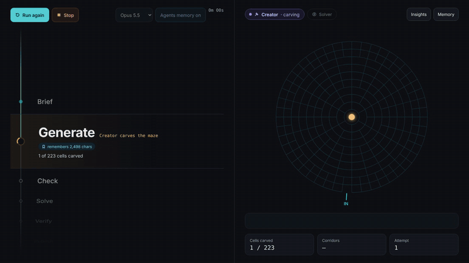
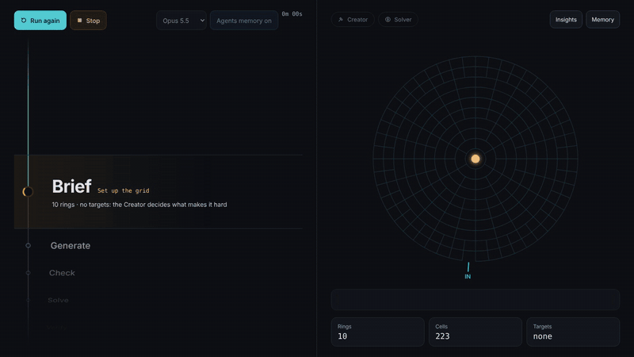
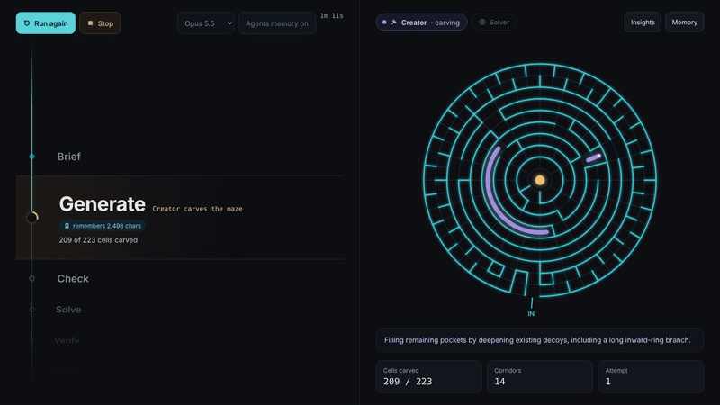
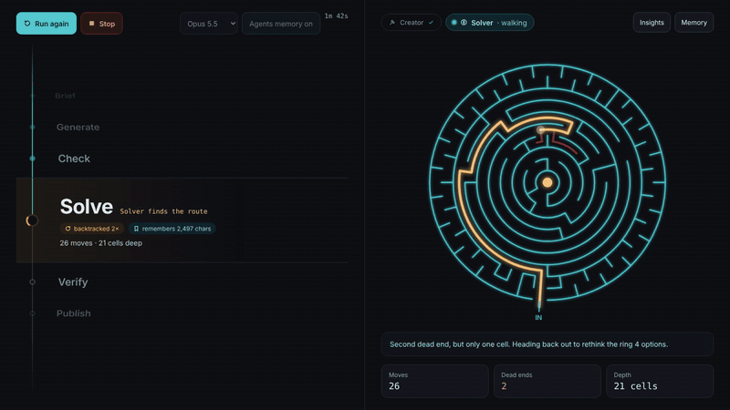
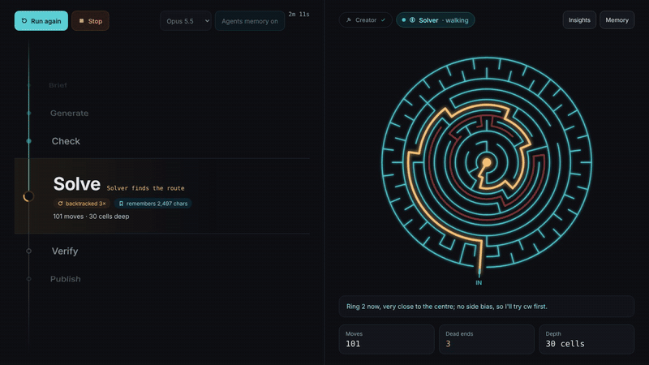
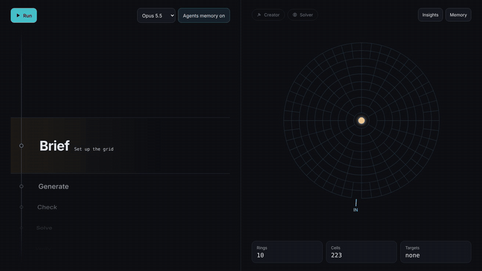
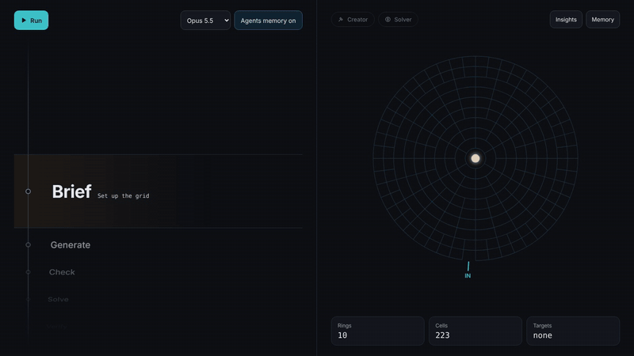

# Claude Circular Maze 2

**Two Claude agents. No rules. They figure it out.**

A real Claude Opus 5.5 run at real speed, with only the waiting cut out. Nothing scripted.

One Claude agent carves a neon circular maze to waste the other's moves. A fresh agent walks it blind and tries to reach the centre as efficiently as it can. Nobody tells either of them how they're scored, what a good maze looks like or how to solve one. They work it out themselves, run after run, in a memory they write however they like.

---

## What's new in v2

- **No Reviewer.** Just Creator vs Solver, head to head.
- **No targets.** No minimum route, no dead-end quota. The Creator decides what makes a maze hard.
- **Free thinking.** No scoring rules, no scoreboard, no strategy tips. Each agent gets only its goal and the plain facts of each run.
- **Free-form memory.** One note per agent, up to 2,500 characters, in any format it likes.
- **Roles on show.** The app shows exactly what each agent is told, above what it remembers.

**What happened:** with no scoring rule, both agents invented their own. The Creator tracks "waste" and writes itself a build recipe and a checklist. The Solver keeps its own ratio log and sets itself a dead-end budget. Its best round so far: a 41-cell route that took the Solver **376 moves**.

---

## 01 · Generate

**The Creator carves.** It cuts corridors through solid rock, one tool call at a time: a spine first, then decoys built to tempt.

## 02 · Check

**Code, not judgement.** A flood fill proves every cell is reachable and there's exactly one way in. Nothing grades difficulty: the Solver is the only judge.

## 03 · Solve

**Blind.** The Solver sees only the openings around it. Here it gets lured into a 28-cell decoy, backs out and finds the real way in.

## 04 · Verify → Publish

**Trust, but replay.** Code re-walks every step against the walls. Then both agents rewrite their memory.

---

## Memory

**Their words, their format.** Each agent's role sits above the memory it wrote itself: run logs, rules and plans for next time.

## Insights

**Every run, side by side.** The app measures each round as Solver moves ÷ fewest possible. The agents never see it.

---

**React · TypeScript · Vite · Hono · Claude API**

Polar maze grid · tool-using agents · live event stream · self-written agent memory

Version 1: [Claude Circular Maze](https://github.com/KrisHHFI/Claude_Circular_Maze)

Built by [KrisHHFI](https://github.com/KrisHHFI)

